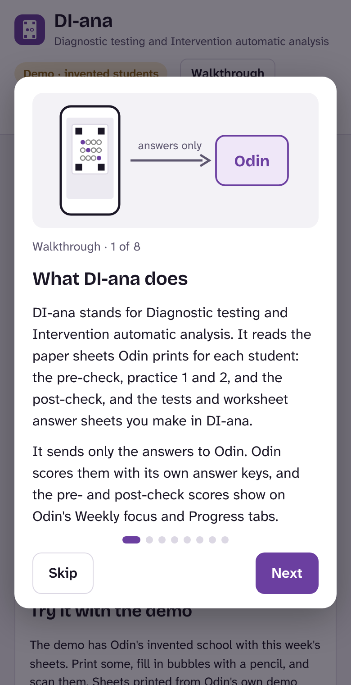
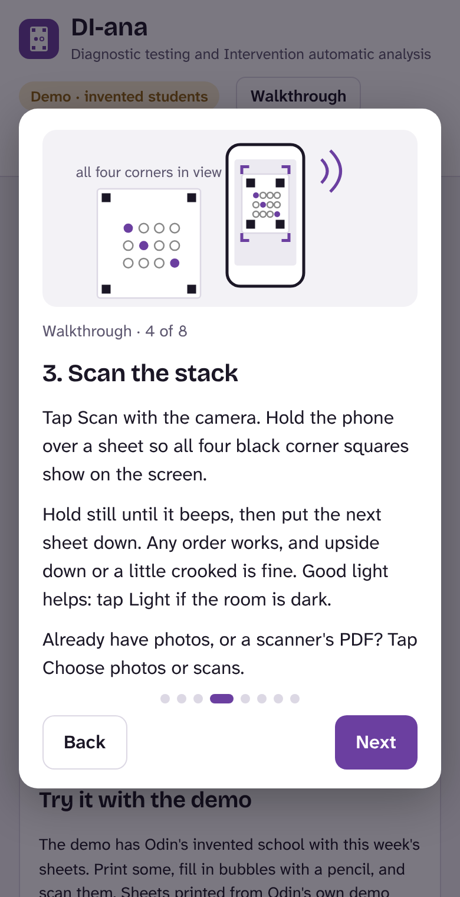
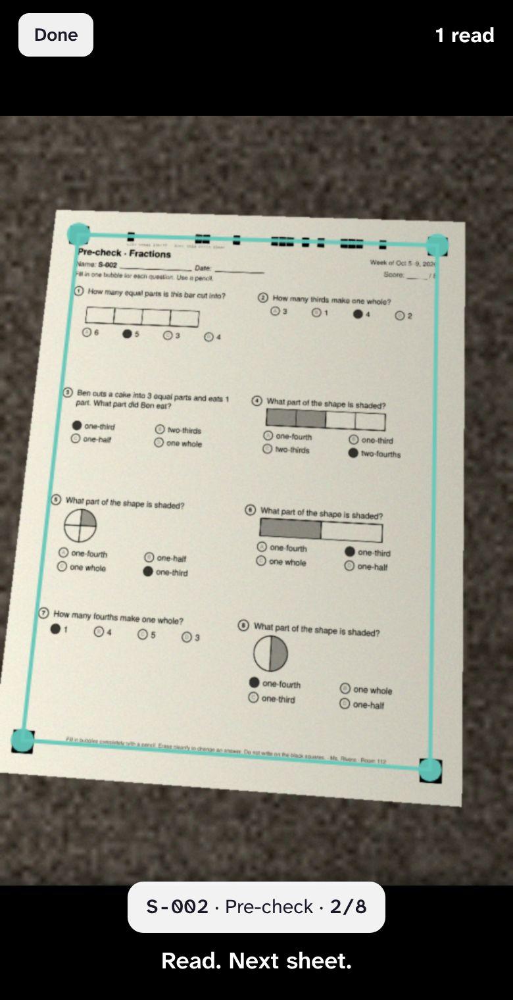
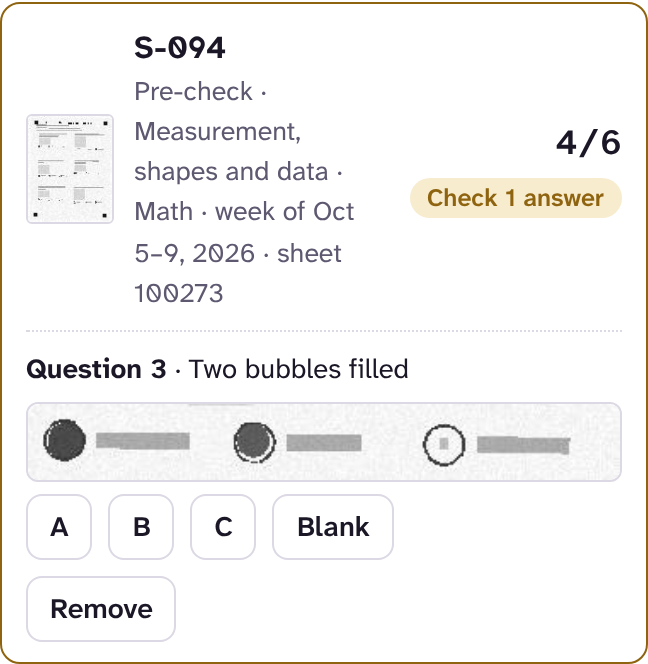
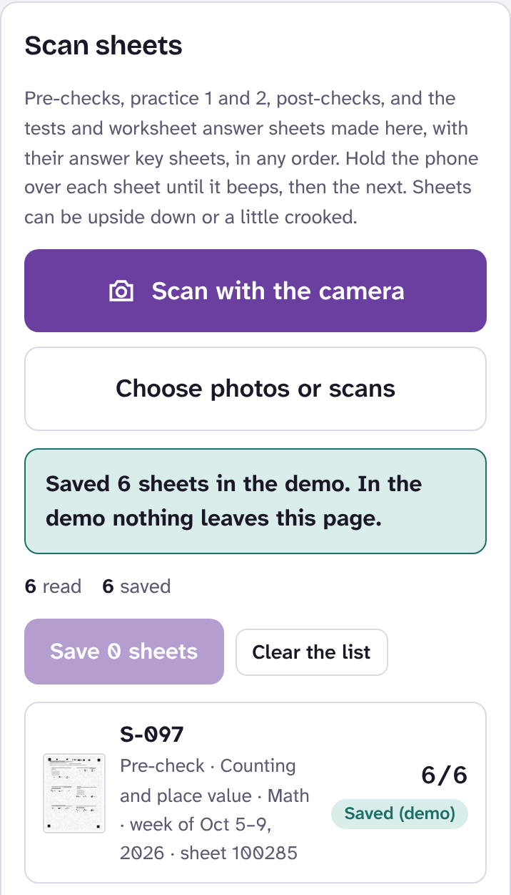
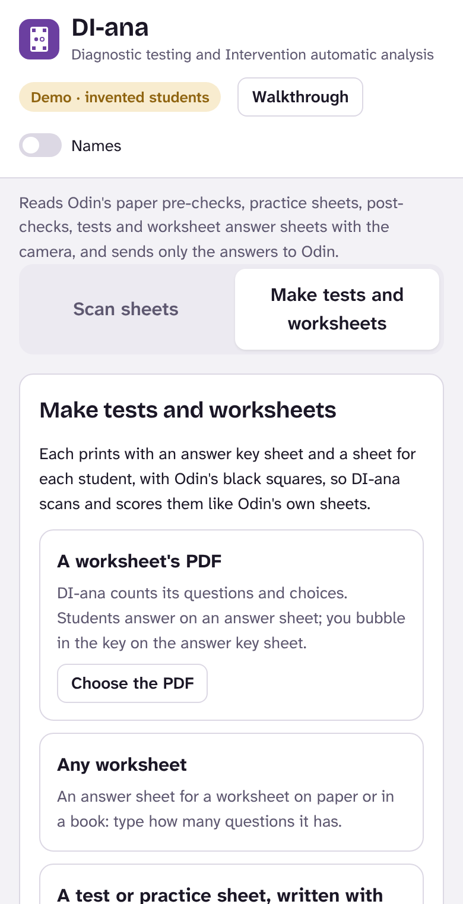
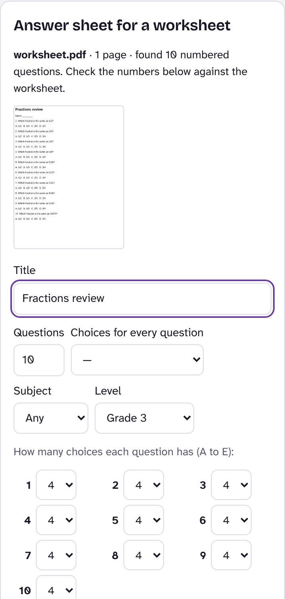
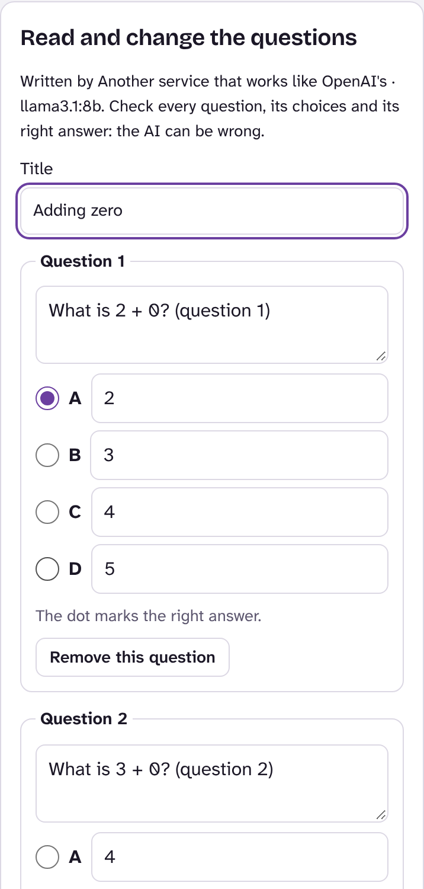
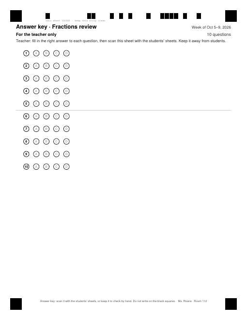

# DI-ana

**Diagnostic testing and Intervention automatic analysis.** DI-ana reads the paper sheets that
[Odin](https://github.com/PurpleNinjaRadish/project-cerabus) (Project Cerberus) prints for each student: the pre-check,
practice 1 and 2, and the post-check. Hold the phone over a sheet until it beeps, then the next one. DI-ana sends only
the answers to the school's Odin server; Odin scores them with its own answer keys and shows the pre- and post-check
scores on its Weekly focus and Progress tabs.

It also **makes tests and worksheets** (0.2): an answer sheet for any multiple-choice worksheet (from its PDF, where
DI-ana counts the questions and choices), or a test or practice sheet written with AI and checked by the teacher. Each
prints with an answer key sheet: bubble in the key, scan it with the students' sheets, and every sheet is scored.

**Try the demo** (invented students only): <https://purpleninjaradish.github.io/Odin-2/diana/> (next to Odin's demo), and
<https://purpleninjaradish.github.io/DI-ana/> once GitHub Pages is turned on here (Settings › Pages › Source: GitHub Actions).
**The Android app:** [diana-android.apk](https://github.com/PurpleNinjaRadish/DI-ana/raw/android-build/diana-android.apk)
(the latest build; its emulator check is on the [android-build](https://github.com/PurpleNinjaRadish/DI-ana/tree/android-build) branch).

Version 0.2.0-alpha. It reads sheets with Odin 0.10.0's scanner (see `odin/SOURCE.json`).

## Walkthrough

DI-ana shows this walkthrough the first time it opens; the **Walkthrough** button at the top opens it again.

1. **Print the sheets in Odin.** On Odin's **Practice** tab, under **View, print or save as PDF**, choose **Pre-checks**,
   **Practice packets** or **Post-checks**, then **Print** (or **Save as PDF**). Print on US Letter at 100% (actual size).
   Each sheet's number is in the black squares at the top, so DI-ana knows whose sheet it is and which one.
   *In the demo, use **Save sample sheets as PDF** instead: Odin's own demo numbers its sheets differently.*
2. **Students fill in the bubbles** with a pencil: one bubble per question, filled in completely, erased cleanly to
   change an answer. Nobody writes on the four black corner squares or the black squares at the top.
3. **Scan the stack.** Tap **Scan with the camera** and hold the phone over a sheet so all four black corner squares show.
   Hold still until it beeps, then put the next sheet down. Any order works; upside down or a little crooked is fine.
   Tap **Light** if the room is dark. Photos or a scanner's PDF work too: **Choose photos or scans**.

   

4. **Check what DI-ana asks about.** A light mark, two filled bubbles or an erased answer shows that question's bubbles
   with A–D buttons: tap what the student meant, or **Blank**. If Odin already has a result for a sheet, DI-ana asks
   before replacing it.

   

5. **Send to Odin.** Press **Send**: only the answers go, and Odin scores them. DI-ana keeps nothing, so send before
   you close it. *In the demo this button is **Save**, and nothing leaves the page.*

   

6. **Make tests and worksheets.** Under **Make tests and worksheets**, choose one of three:
   - **A worksheet's PDF**: DI-ana counts its numbered questions and each one's choices, and shows its pages. Check the
     numbers (and the worksheet's own answer key, if it has one). Students answer the worksheet on Odin's answer sheet.
   - **Any worksheet**: type how many questions it has and how many choices each has (2 to 5, A to E).
   - **A test or practice sheet written with AI**: pick the grade, subject, skill and topic. Read and change every
     question, its choices and its right answer: the AI can be wrong.

   Pick the class and students, then print the PDF: an **answer key sheet** and a sheet for each student. When the key
   isn't known, fill in the key sheet's bubbles and scan it with the students' sheets, or tap the key in.

   

   
   
   

7. **At school**, in the Android app: type the address teachers use for Odin (it starts with https://) and sign in with
   Odin's password, on the school network. DI-ana needs Odin 0.9.5 or newer to scan, and 0.10.0 or newer to make tests and
   worksheets. Use real student information only on the school's Project Cerberus server, with the school's written approval.

The pictures come from the demo (`python3 tools/walkthrough_pictures.py`); every student in them is invented.

## What it does

- **Live camera.** DI-ana looks for Odin's four black corner squares a few times a second. When the sheet holds still,
  it reads the sheet number and every bubble, beeps (and buzzes on Android), and waits for the next sheet. A sheet stays
  read once even if it stays in view. Sheets can be upside down, sideways or a little crooked, on any desk, in uneven light.
- **Photos and scans.** Pick photos already on the phone, or a scanner's PDF, JPEG or PNG files.
- **Answers to check.** A light mark, two bubbles filled, or an erased answer is shown as a small picture with A–D
  buttons, the same as Odin's own scanner.
- **Send to Odin.** Nothing goes to Odin until you press Send. A sheet that already has a result in Odin is replaced
  only if you say so. Pre- and post-check scores land on Odin's Weekly focus and Progress tabs.
- **Tests and worksheets.** Answer sheets for any multiple-choice worksheet (up to 60 questions, 2 to 5 choices), and
  tests and practice sheets written with AI. Each has an answer key sheet: filled in when the key is known; bubbled in by
  the teacher and scanned when it isn't. Odin keeps them and shows each student's score on its Practice tab.
- **The AI.** At school, Odin's server calls the AI the school chose (on a school computer, a free tier or paid) and keeps
  its key. In the demo, DI-ana calls it, and a key typed there is kept only while DI-ana is open. See Odin's wiki page
  [Writing with AI](https://github.com/PurpleNinjaRadish/project-cerabus/blob/main/wiki/Writing-with-AI.md).
- **The demo** has Odin's invented school with this week's sheets. Print sample sheets (as a PDF), fill in bubbles with
  a pencil, and scan them, or try pretend pictures with no paper at all. In the demo nothing leaves the page.

## Privacy

- Pictures are read in the phone's memory and are never saved or sent. Only the answers go to Odin.
- Nothing about students stays on the phone: the list is cleared when DI-ana closes, the sign-in ends, and Android
  hides DI-ana's screen from screenshots and the app switcher while it is connected to a school's Odin.
- The Android app reaches only the Odin address it is given, only over HTTPS, and only Odin's API. The password is sent
  to Odin once and not kept; the sign-in's session is kept in memory only.
- The app's page is built into the app. It never loads anything from the internet.
- **The AI is told only the grade, subject, skill and topic**, never anything about a student. DI-ana, and Odin again,
  refuse a topic with a student's name or code in it. A worksheet's PDF is read on the device and never sent or kept.
- Use real student information only on the school's offline Project Cerberus server, after written approval from the
  school or district.

## Using it at school

1. Odin 0.9.5 or newer on the school's server (DI-ana uses its `/api/scanner` and `/api/sheet/result`); 0.10.0 or newer to
   make tests and worksheets (`/api/sets`, `/api/ai/chat`).
2. Install `diana-android.apk` on the teacher's phone (Settings may ask to allow installing apps from this source).
3. Open DI-ana, type Odin's address (the same one teachers use, starting with https://), and sign in with Odin's password.
4. **Scan with the camera**, then **Send** when the stack is done.

The test key in `android/keys` signs these builds. For the district, build with the district's own key
(`DIANA_KEYSTORE`, `DIANA_KEY_ALIAS`, `DIANA_KEY_PASS`).

## How it is built

| Folder | What's there |
|---|---|
| `odin/` | Odin's sheet maker, PDF writer and scanner, **copied from Odin and never edited here** (`tools/sync_odin.py`) |
| `web/src/` | DI-ana's page: `diana.js` (the camera, reading, the list, sending, making tests and worksheets), `worksheet.js` (a worksheet's PDF: its text and questions), `diana.css`, `head.html` |
| `web/vendor/pdfjs/` | pdf.js 3.11.174 (Apache 2.0), loaded only when a worksheet's PDF is chosen |
| `web/build.py` | Builds `dist/index.html` (GitHub Pages) and the copy inside the Android app |
| `tools/demo_data.js` | The demo: Odin's invented school with this week's sheets, made by Odin's own sheet maker |
| `android/` | The Android app: `MainActivity` (setup, the camera permission, the print screen) and `DianaBridge` (sign-in and requests to Odin) |
| `web/tests/test_diana.py` | Page tests: the demo, photos on a desk, the live camera (a pretend camera playing a video), tests and worksheets (with a stand-in AI, `fake_ai.py`), and the school's server |
| `android/ci/` | The emulator check: the demo, the camera, and sending to a stand-in Odin through the app |

Build: `python3 web/build.py` (Python 3.9+ and Node.js). Test: `python3 web/tests/test_diana.py`; with a running Odin
(`ODIN_PASSWORD=test-pass python3 server.py` in Odin's folder) add `ODIN_URL=http://127.0.0.1:8080`.

**Keeping DI-ana in step with Odin.** When Odin's sheets, scanner or PDF pages change, run
`python3 tools/sync_odin.py /path/to/project-cerabus`, rebuild and test, and commit both. DI-ana checks every sheet:
if its copy of Odin draws a sheet with a different answer key than the server's, it says the sheet came from another
version of Odin and doesn't read it.
